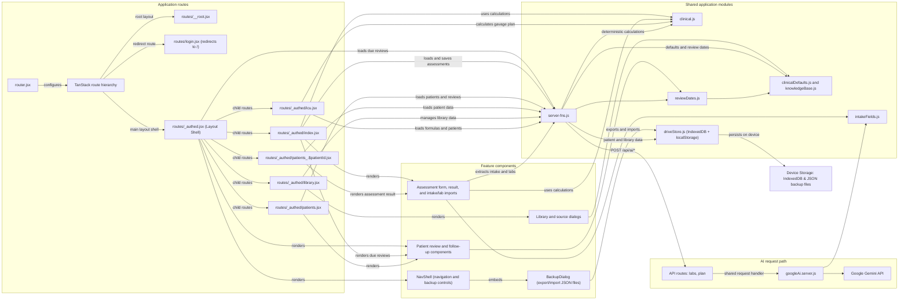

# Code structure graph

This graph summarizes first-party modules under `src/` at the route and feature level. It excludes dependencies, generated route metadata, build output, environment files, and low-level UI primitives. The TanStack route hierarchy is shown conceptually; `routeTree.gen.ts` is not expanded.

Solid arrows indicate module imports, calls, or framework route relationships. Grouped nodes collapse related components and API handlers for readability.

